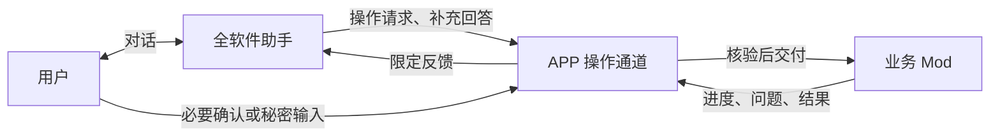

# WindowsToLinux APP 智能助手开发规划：全软件操作助手与 Mod 操作 API

## 文档状态与范围

- 状态：后期独立规划，尚未排期、实施或验收；记录本次讨论中的需求、职责边界、候选方案及待定事项。
- 排期决定：助手功能及新增 Mod 业务操作 API **不纳入 1.3**，待时机成熟后另行评审并启动开发，不自动指定为 1.4 或其他期数。
- 文档位置：与各期文档同放在 `docs/development/`，通过[开发总纲](DEVELOPMENT.md)导航；本专题的讨论正文只在本文维护。
- 与 1.3 的关系：[1.3 执行计划](PHASE-1.3.md)继续执行窗口 P0、ModDev、Git 独立化、部署完整迁移及文件管理等原范围；不为本专题提前增加通用操作通道或额外 UI 接口。
- 实现状态：当前已有通用 AI、任务、交互及跨 Mod 服务基础，不代表已有本文所述的全软件助手、动态操作目录或任务交接通道。本文中的接口名称、结构和顺序均不作为已发布合同。

## 1. 已确认的需求与职责

用户不熟悉软件操作时，可以通过对话表达目标，由助手帮助理解功能、确定操作对象、补齐必要参数、发起操作，并解释实际进度、问题和结果。

这里的助手与部署 Mod 内部的 Agent 分工不同：助手面向全软件的人机交互和任务协调；部署 Agent 面向部署领域，负责项目分析、部署方案、具体执行及失败处理。助手可以决定下一步询问什么或调用哪个公开业务操作，但不接管各业务 Mod 的专业实现，也不把领域 Agent 降级为固定按钮选择器。

| 部分 | 职责边界 |
| --- | --- |
| 全软件助手 | 理解用户目标、选择功能、收集参数、协调任务、观察状态、解释结果，并在需要时让用户接手。 |
| APP | 提供平台操作通道，核验身份与授权，承载确认、输入、任务准入、互斥、取消、观察、记录和资源生命周期。 |
| 业务 Mod | 提供允许外部调用的业务操作，验证业务条件，完成执行、结果核对及必要恢复；需要时使用自己的领域 Agent。 |

例如“帮我把这个项目部署到这台服务器”：助手先确定项目、服务器和部署模式，再把明确请求交给部署 Mod；部署 Mod 按所选模式进入普通流程或部署 Agent。助手随后查询进度、解释问题，并向用户收集部署流程缺少的信息。

已确认需要补充 APP 与 Mod 之间的通用业务操作 API。助手内置或插件化都不能取消这条边界；APP 不通过私有实现、私有数据表或界面控件绕过 Mod 的公开业务合同。

## 2. 助手的封装方式：优先方案与替代方案

最初设想是独立、可选的 Agent Mod；后续讨论提出直接内置 APP。当前优先评估“APP 内部独立助手模块，用户可关闭”的方案，最终封装形态仍待后期正式评审，不把建议记成已经落地的决定。

| 方案 | 主要收益 | 主要取舍 |
| --- | --- | --- |
| APP 内部独立助手模块（优先候选） | 更容易统一工作区上下文、导航、平台交互和任务协调；助手所需的平台内部能力不必全部变成作者公开 API。 | 助手更新通常随 APP 发布；需保持独立职责和验证范围，防止业务实现向 APP 汇集。 |
| 独立 Agent Mod | 用户按需安装，便于独立更新、替换不同助手实现。 | 需要更完整的受限上下文与操作 API，以及明确的跨 Mod 兼容和调用授权。 |

内置方案仍保持助手与业务 Mod 的分工。部署、Git、文件管理等业务不因此迁入 APP；通用模型调用与凭据保护继续复用平台基础。关闭助手后，普通界面及非 AI 操作不依赖助手或助手模型配置，也不启动助手的模型请求或后台循环；业务 Mod 自身的 AI 配置仍按其所选模式要求处理。代码模块、包名、界面入口、默认开关和数据归属在正式实施前确定，不提前创建目录或更新实际源码索引。

内置不自动意味着执行更安全。助手同样经过平台操作通道；模型不因处于 APP 内部就获得任意内部服务调用、私有数据库读取或任意命令执行权。

## 3. APP 与 Mod 的通用业务操作 API

### 3.1 定位与接入方式

候选名称为 `ModOperationService`，表示平台与业务 Mod 的操作通道；名称、包位置和方法签名未定。本通道可供普通界面和助手复用，不要求各 Mod 依赖助手，也不要求每个 Mod 实现 AI。

业务 Mod 按需提供程序可调用的业务入口，并注册希望被平台发现和调用的操作。已有公开接口可以通过提供方或明确的适配层接入；没有公开业务入口的功能不能自动获得代操作能力。操作目录可发现仅表示合同存在，实际执行仍需当前授权、版本和业务条件检查。

一个业务操作应说明稳定操作标识、提供方身份、合同版本、功能说明、参数与结果格式、前置条件以及支持的控制方式。声明用于发现和校验，不能单靠作者填写的“低风险”标签或模型判断解除授权检查。

### 3.2 两个调用方向

| 方向 | 能力 |
| --- | --- |
| Mod → APP | 注册允许调用的操作；声明参数和结果合同；回报进度、结果及结构化补充信息请求；随自身生命周期撤销注册。 |
| APP → Mod | 查询已启用、兼容且当前可见的操作；校验和提交参数；发起业务执行；回复原操作的问题；按合同请求取消或核对结果。 |

普通界面按钮和公开操作入口复用同一业务用例，避免另外实现一套“给 AI 用的业务”。功能内部如何布局、使用哪个领域 Agent、如何组织代码，由业务 Mod 自己决定。

### 3.3 所需能力

以下是讨论形成的能力清单，不要求每一项增加独立服务，也不代表首版一次实现全部扩展。

| 能力 | 所需信息或行为 | 边界 |
| --- | --- | --- |
| 操作发现与说明 | 有界列举可见操作、功能说明、版本、前置条件和帮助信息。 | 未安装、未启用、不兼容或无权使用的提供方不能作为可执行目标。 |
| 参数规格 | 必填项、类型、合法选项、输入限制及结果格式。 | 助手不能凭空补出业务参数；默认值也须由提供方校验。 |
| 当前上下文 | 当前工作区、用户主动选中的项目/目录/服务器、关联任务及状态修订。 | 未选择或有歧义时明确返回；可见元数据不等于执行授权。 |
| 候选对象查询 | 服务器、项目、应用等摘要，支持筛选、分页和明确标识。 | 平台对象复用 APP 能力；业务对象由所属 Mod 提供，避免跨 Mod 私有查询。 |
| 操作预览 | 实际目标、主要影响、冲突、待确认项及相应修订。 | 预览不是执行许可；目标或参数变化后重新核验。未实现预演的操作不能伪装为“试运行成功”。 |
| 发起与观察 | 校验后的结构化请求、操作引用、接纳状态、任务关联、进度和最终结果。 | 不把任意 Java 方法、闭包或界面对象暴露给模型；观察仅限允许范围。 |
| 结构化交互 | 缺失信息、可选项、输入限制、问题标识及绑定原任务的回答。 | 普通参数回答与授权确认分开；秘密输入由宿主处理，不进入模型上下文。 |
| 结果与错误 | 成功、失败、部分完成、结果不明；实际输出、诊断类别与允许的后续操作。 | 不依赖解析原始日志猜结果，不把请求取消或超时当成执行已经终止。 |
| 请求身份与重复保护 | 原请求标识、任务关联、接纳事实及重复请求核对。 | 不同参数不能复用原确认；断连后先核对原请求，不自动发起第二次执行。 |
| 界面衔接 | 打开 Mod 根工作区，定位其公开内部位置，展示待确认参数。 | 内部定位由 Mod 处理；沿用一个 Mod 一个主导航入口，不开放任意控件操纵。 |
| 生命周期与限额 | 提供方可用性、版本变化、订阅释放、取消、超时和有界资源使用。 | 停用或更新后旧引用不能继续发起新操作；已接纳任务按其实际规则收尾。 |

暂停、重试、撤销和恢复属于操作可选能力，由业务 Mod 明确声明并实现。不能假定所有业务都可暂停或回滚，也不能用统一“撤销”按钮承诺恢复所有副作用。

### 3.4 业务操作与平台管理分别授权

调用部署、Git、文件管理等业务功能走本通道。启用、禁用、更新、删除 Mod，以及更改平台权限、模型配置等属于 APP 平台管理，保持独立授权；注册业务操作不授予这些管理权。

若助手以后支持平台管理操作，需要逐项确定公开范围和确认方式，不能因“全软件助手”默认全部开放。

## 4. 双向流程与用户接手

部署 Mod 缺少启动参数时，提交结构化问题；APP 将问题关联到原操作，助手向用户询问，再把答案经 APP 交回原任务。部署 Mod 不调用助手的模型，也不依赖助手存在；没有助手时，同一问题可以由普通界面承载。

授权确认由宿主承载并核验，助手可解释影响和引导用户确认，但不能自行生成“用户已经同意”的结果。输入、回答、确认和状态事件均绑定具体任务、对象及问题，防止回答交给错误任务。

用户可以从助手切回业务工作区继续操作。待确认参数与当前业务状态的衔接须避免覆盖用户后来修改的内容；助手关闭、用户接手后任务是否继续、交互如何转移及观察何时释放，仍待设计。

## 5. 任务交接、结果核对与授权

现有跨 Mod 服务调用在原任务中同步执行；任务系统明确禁止在依赖调用中再次提交新任务，返回 `SERVICE_TASK_REENTRY`。后期不能直接实现为“助手先提交任务 → 在原同步服务调用内让部署 Mod 再提交部署任务”，也不能让双方重复占用同一服务器来模拟交接。

推荐候选：APP 受理助手请求，按明确授权为提供方建立业务任务；业务执行归提供方 Mod，记录助手发起来源及用户授权关联；助手获得限定的观察、补充信息和请求取消能力。具体准入、调用方/提供方身份、服务器互斥、资源归属和恢复合同，须与现有原任务调用机制一起评审，不为新通道削弱既有规则。

上下文交接也须受控。现有文件选择绑定原任务及实际来源对象，目录 URI、路径或复制的 ID 不证明新任务有权读取；转交给部署等业务时，需要明确素材、快照或引用的验证、授权与释放责任。

请求授权限定目标、操作、参数与寿命；目标、版本或输入变化后重新核验。凭据留在执行端，助手和模型只获得必要的非秘密引用或状态。查询到服务器资料不等于取得使用服务器的授权。

断连、超时或响应丢失后，通过原请求与任务核对是否接纳、实际执行阶段和结果；结果不明时保留原状态，不自动重发。请求取消与实际取消完成分开，成功、失败、部分完成和未知副作用如实报告。恢复逻辑由业务提供方负责；助手会话和授权不能在 APP 重启后自动视为继续有效。

## 6. 安全与替代方案

- 执行端对每次请求检查调用范围、身份、当前授权及业务条件，模型输出不作为授权凭证。高影响操作展示具体对象和实际影响，不能仅问一句笼统的“是否继续”。
- 文件正文、日志、网页及业务反馈属于输入数据，其中的文字不能自动变成用户指令、权限申请或新的操作授权；发给模型的数据范围与敏感信息处理方式在后期明确。
- 助手不默认拥有任意命令执行、私有 Schema 查询、任意文件读取或全局配置修改权。审计、操作请求和对话记录区分，秘密不写入模型上下文、日志或记录。
- 现有 Mod 按可信本地代码运行，同进程类加载器不是恶意插件沙箱。操作通道主要约束正规调用和模型产生的动作；若要支持不可信助手代码，需另外评审进程和操作系统权限隔离，单纯启动辅助进程不保证隔离。
- 可先采用“对话填表与操作预览”，用户确认后进入原业务流程，再扩展连续代操作。该顺序为候选，不把固定表单辅助宣称为完整自主助手。
- 模拟鼠标键盘可作为特定场景的另行方案，但依赖布局、焦点和弹窗，不作为默认业务调用通道；各 Mod 自由布局会增加适配成本。真正的外部软件需要专门 API、命令行或适配器，不因 APP 代理而自动可控。

## 7. 当前 API 基础与缺口

以下按 2026-10-04 当前工作区接口核对，后期正式实施前重新检查。仅说明可复用基础，不声明已完成本文功能。

| 当前接口 | 可复用基础 | 与助手通道的差距 |
| --- | --- | --- |
| [ModServices](../../src/appapi/src/main/java/gold/debug/windowstolinux/appapi/mod/service/ModServices.java) / [ServiceHandle](../../src/appapi/src/main/java/gold/debug/windowstolinux/appapi/mod/service/ServiceHandle.java) | 所属服务登记、声明依赖后的强类型发现、原任务同步调用。 | 不是可选业务操作动态目录；不能把同步调用代理长期保存或直接转授给助手。 |
| [TaskService](../../src/appapi/src/main/java/gold/debug/windowstolinux/appapi/task/TaskService.java) / [TaskHandle](../../src/appapi/src/main/java/gold/debug/windowstolinux/appapi/task/run/TaskHandle.java) | 任务准入、状态、完成结果、请求取消及原任务恢复。 | 需设计助手发起与提供方执行的受控交接；不开放跨 Mod 全部任务观察。 |
| [InteractionService](../../src/appapi/src/main/java/gold/debug/windowstolinux/appapi/task/action/InteractionService.java) | 宿主审批、文本输入。 | 需评审结构化问题、选项、原任务回答及助手/界面之间的交互转移。 |
| [AiService](../../src/appapi/src/main/java/gold/debug/windowstolinux/appapi/ai/AiService.java) | 任务授权、模型调用、预算和配置修订。 | 助手目的路由、会话与总限额仍待明确，不重写模型或凭据底座。 |
| [ServerService](../../src/appapi/src/main/java/gold/debug/windowstolinux/appapi/server/ServerService.java) | 授权范围内查询及仅供选择的非秘密配置摘要。 | 不等于已有助手上下文或目标使用授权；业务对象仍由对应 Mod 查询。 |
| [UiService](../../src/appapi/src/main/java/gold/debug/windowstolinux/appapi/ui/UiService.java) | 所属页面挂载、打开和主题/语言/锁定环境。 | 目前不是全局工作区上下文和跨 Mod 内部定位合同；1.3 窗口结果在后期承接。 |
| [Problem](../../src/appapi/src/main/java/gold/debug/windowstolinux/appapi/task/result/Problem.java) | 非秘密的结构化错误及诊断引用。 | 需由业务操作提供可解释结果和允许的后续行为，不依赖原始日志猜测。 |
| [DeploymentApi](../../src/mod/deployment/src/main/java/gold/debug/windowstolinux/mod/deployment/api/DeploymentApi.java) | 应用检查、生命周期及备份交接。 | 当前没有助手所需的完整发起部署入口；后期通过公开业务操作接入，避免私有宿主访问。 |

## 8. 后期建议开发顺序与验证方向

以下仅作为未来启动开发时的候选顺序，当前不建立实施进度，也不启动目标模式。

1. 复核届时 APP/API、1.3 窗口及业务 Mod 实际状态，确定助手封装方式、首批场景、授权和任务交接合同。
2. 用一个真实业务场景验证操作登记、发现、参数校验和明确发起，复用原业务用例与平台基础。
3. 接通进度、结构化问题、用户回答、结果核对、取消与界面接手，验证一个完整闭环。
4. 在此基础上加入对话协调，再逐步扩展其他 Mod；不要求首版操作全软件，也不一次开放全部内部能力。

候选首个闭环：用户表达部署目标 → 识别或选择对象 → 补齐参数 → 交给部署 Mod 准备 → 展示其返回的方案或具体操作影响 → 经 APP 承载必要确认后进入所选执行流程 → 回传进度和缺项 → 用户补充或接手 → 核对实际结果。专业方案由部署 Mod 及其所选模式生成，助手负责解释和转交；执行过程中新增的必要审批继续遵守原业务合同。

验证应覆盖提供方缺失/停用/版本变化、参数和目标漂移、拒绝确认、锁定、重复请求、断连未知结果、取消、部分完成、资源释放和重启后核对。助手解释以结构化实际结果为依据；普通界面在关闭助手时仍可使用。静态接口、编译和受控夹具通过不等于真实模型或真实 Linux 全流程验收。

## 9. 后期正式设计前待定事项

| 事项 | 待明确内容 |
| --- | --- |
| 封装与入口 | APP 内置独立模块还是 Agent Mod；界面位置、默认开关、发布/更新与替换方式。 |
| 公共合同 | 操作通道名称、包位置、参数/结果格式、版本策略、动态发现与已有强类型服务的关系。 |
| 任务与授权 | 发起方、执行方、任务所有者、平台准入、精确确认、观察范围、取消及助手关闭后的行为。 |
| 上下文与素材 | 哪些选择可供助手读取，用户修改后的修订，跨任务素材交接、快照和资源释放责任。 |
| 交互与事件 | 结构化问题、回答来源、确认及秘密输入、等待与超时、事件顺序和订阅释放、界面接手。 |
| 状态与恢复 | 原请求登记、重复保护、未知结果核对、提供方更新/停用和 APP 重启后的处理。 |
| 模型与记录 | 助手用途路由、循环/调用/时间/费用限额、对话存储和清理、可发送数据及敏感信息处理。 |
| 首批支持范围 | 优先闭环、业务 Mod 接入项、第三方可选适配与实际验证环境。 |

## 10. 相关文档与参考

- [开发总纲](DEVELOPMENT.md)：各期导航与文档职责。
- [1.3 执行计划](PHASE-1.3.md)：本专题不纳入该期，未来按实际完成结果承接窗口与业务能力。
- [Mod 规范](../reference/Mod.md)：现有公开契约、调用、生命周期及信任边界。
- [APP 文档](../reference/APP.md)与[源码结构规范](../reference/File.md)：平台职责与实际模块边界；本文候选结构不提前记入实际索引。
- [OWASP Excessive Agency](https://genai.owasp.org/llmrisk/llm062025-excessive-agency/)：最小功能与权限、执行端授权检查和高影响操作确认。
- [OWASP AI Agent Security](https://cheatsheetseries.owasp.org/cheatsheets/AI_Agent_Security_Cheat_Sheet.html)：操作预览、精确授权绑定、结构化输出与重复执行保护。
