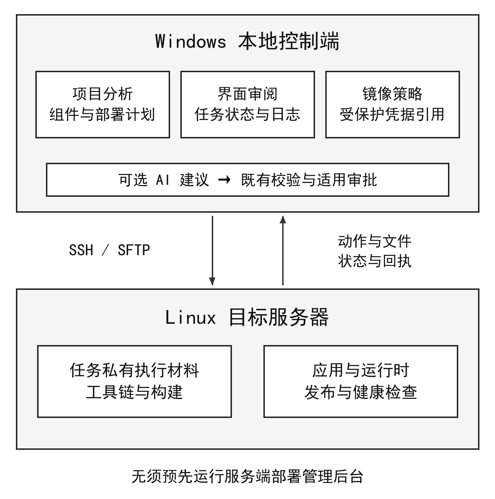
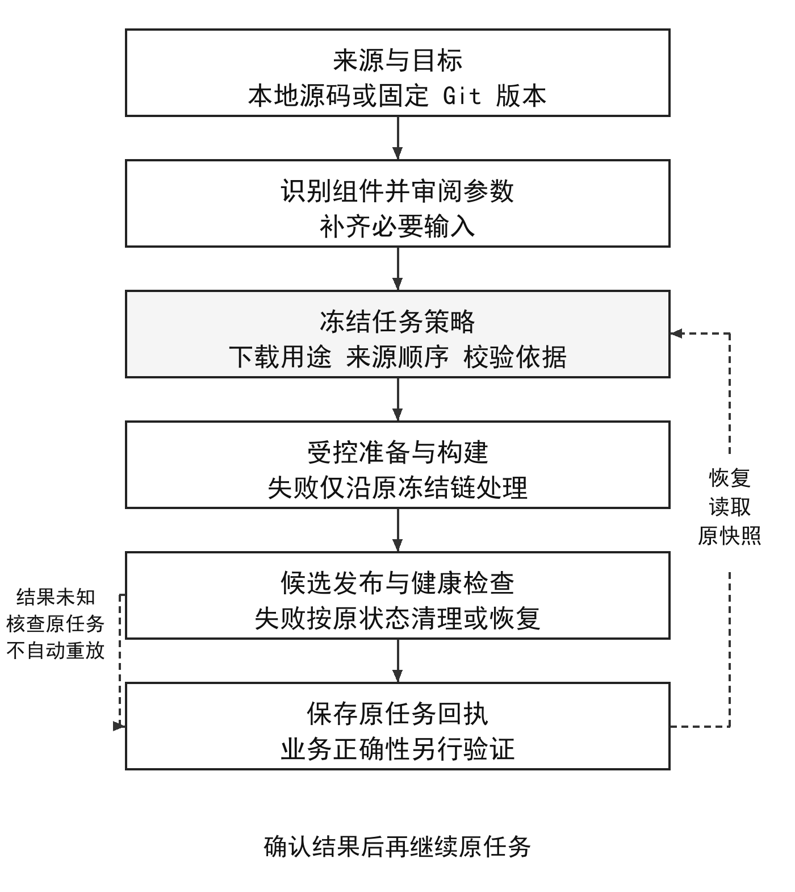

# 面向个人自托管的 Windows 桌面多语言应用自动部署方法

<!-- 中文内容源稿；附录为编辑材料，不进入 Word 论文正文。 -->

> 中文审阅稿 v1 · 临时排版 · 2026-11-04。作者、单位及通讯信息待补。本文按约六页英文会议论文的内容容量组织，尚未取得会议专用模板；当前文稿不属于可直接投稿的英文终稿。

**摘要**　个人开发者通常需要在已有 Windows 计算机上，将包含不同语言和构建工具的应用部署到 Linux 服务器。自托管 Web 管理平台提供了集中的部署入口，但其服务端管理组件也需要安装和维护；通用远程自动化工具则通常要求用户编写脚本或配置。本文提出一种面向个人自托管的桌面式部署方法，并实现原型系统 WindowsToLinux。系统将交互、项目分析、部署编排及任务记录放在 Windows 本地，通过 SSH 和 SFTP 调用 Linux 端的受管执行能力，按需准备应用所需环境，无须预先运行服务端部署管理后台。方法将源码语言、构建工具和组件关系分别建模，并按任务冻结下载来源、校验策略和恢复依据；可选 AI 建议须通过既有配置校验及适用审批后进入执行。本文给出架构、实现和验证范围，整理历史 Ubuntu 环境下八个混合语言项目的部署及代表性业务记录，并说明当前镜像与命令约束的本机受控验证。现有证据支持所述流程的实现可行性，但尚不能证明相较现有平台具有资源、效率或易用性优势。进一步研究需要在同版本、同工作负载下完成对照测量。

**关键词**　应用部署；Windows 桌面；多语言应用；自托管；任务恢复；AI 辅助

## I 引言

将一个项目从源码转换为可用服务，涉及依赖准备、版本选择、构建、启动配置和结果检查。个人开发者可能已经拥有 Windows 计算机和一台 Linux 服务器，却没有持续运行的部署控制节点。对于混合语言项目，前端、后端与辅助程序还可能分别使用不同工具链；某个组件能够启动，并不意味着组件之间的调用、文件处理或持久化已经正确工作。本文关注如何把这些步骤组织成个人能够审阅和执行的部署任务。

现有工具已经覆盖这一问题的多个方面。Ansible 通过控制节点远程执行自动化任务，其管理节点不必安装 Ansible，但常用模块仍有运行环境要求；Windows 作为控制节点需借助 WSL 等受支持环境[1]。Coolify 和 Dokploy 提供浏览器管理入口，自托管时需要在所管理的基础设施上安装相应服务[2], [3]。这些服务可以与应用共用服务器，不能据此认定 Web 部署必然需要额外物理主机。WinSCP 则已经提供 Windows 图形界面、脚本和自动化接口[4]，因此“从 Windows 远程操作 Linux”本身不是本文的创新点。

本文研究的问题是：在已有 Windows 终端和可通过 SSH 访问的 Linux 服务器之间，能否集成项目识别、多组件部署、来源控制及结果核验，而不要求用户预先搭建服务端管理后台？这里的环境简化指减少额外控制平台的部署与维护，并不意味着 Linux 端不写入文件、不安装运行时或完全没有辅助程序。Windows 端的开销同样属于系统成本，不能从比较中排除。

本文的贡献包括三个方面。首先，给出本地桌面控制与远端受管执行的职责划分，将原本分散的部署操作组织为具有审阅和结果记录的任务。其次，区分源码语言、构建方式与组件协作，以统一流程处理单组件和混合语言应用。最后，将按下载用途配置的来源及校验规则冻结到具体任务，使恢复过程保持原决策依据，并将 AI 辅助限制在既有执行约束内。本文提供系统实现及分层验证证据，尚不将设计目标作为对照实验结论。

## II 相关工作

### A 声明式与模型驱动部署

TOSCA 通过应用拓扑和管理计划描述异构组件及其关系，支持部署管理的可移植性[5]。TosKeriser 在不完整 TOSCA 描述中补全 Docker 运行环境，并以案例展示多组件编排[6]。TORCH 以 TOSCA 为基础研究多云应用编排，分离资源准备流程与云平台 API 调用[7]。BESSER 的部署扩展定义部署架构语言，并结合代码生成和 Terraform 支持多云部署[8]。这些研究均具有系统或工具支撑，不能归为只有概念论文的工作；它们也不局限于单一应用语言。

本文与上述方法的差异主要在使用场景和流程入口：本文直接面向已有 Windows 终端及 Linux 目标服务器，将受支持项目的识别结果转化为可审阅部署任务。本文不试图替代 TOSCA 的通用建模能力，也不把多语言组件图本身作为新算法。

### B Web 平台与远程工具

Coolify、Dokploy 将部署操作放入 Web 工作流，具有多应用管理及容器集成能力[2], [3]。Ansible 提供可复用的远程自动化机制[1]；WinSCP 集成图形化文件传输与脚本接口[4]。表 I 比较这些工具的运行前提与本文关注的流程差异。表中的能力依据官方文档归纳，并非本研究完成的性能基准测试。

**表 I　代表性工具与原型的运行方式比较**

| 工具 | 控制端及运行前提 | 与本文问题的关系 |
| --- | --- | --- |
| Ansible [1] | 支持的类 Unix 控制环境；Windows 可用 WSL | 远程自动化成熟，需准备清单、任务和部署配置 |
| Coolify [2] | Linux 上的自托管管理服务；浏览器访问 | 集成应用部署；管理服务可与应用同机运行 |
| Dokploy [3] | 服务器端安装部署管理服务；浏览器访问 | 集成部署与服务管理，仍需维护平台本身 |
| WinSCP [4] | Windows 图形界面及脚本接口 | 已支持传输自动化；完整构建、发布与业务检查需另行组织 |
| 本文原型 | Windows 桌面控制端及可访问的 Linux 目标 | 将识别、审阅、执行、来源策略和核验组织为同一任务；优势仍待实测 |

### C AI 辅助部署

AI2Agent 通过指引执行、调试和案例积累支持 AI 项目部署，并公开了代码和演示[9]。Esposito 等提出利用 DevSecOps 各阶段产物生成和改进基础设施代码的研究框架，其论文将后续实证验证作为研究路线的一部分[10]。这些工作说明 AI 可以进入部署流程，但其输出仍需执行与验证。本文聚焦 AI 建议如何与已有确定性流程结合，不以模型生成了命令或模型审批通过作为部署成功依据，也不将不同模型或不同研究数据集的结果直接比较。

## III 方法与架构

### A 控制端与执行端分工

系统由 Windows 桌面控制端、SSH／SFTP 通道和 Linux 执行端组成，如图 1 所示。控制端使用 Java 21 与 Swing 实现交互，保存服务器资料、任务状态和受保护凭据引用，并组织项目分析、参数审阅、执行和恢复。业务部署由独立模块接入，模块机制只承担能力组织，不改变远程执行的权限边界。

*图 1　Windows 本地控制与 Linux 受管执行的职责划分。图中运行时与辅助文件均属于远端实际开销。*

SSH 提供远程认证及加密通道[11]；首次连接需要核对服务器主机指纹。Linux 端接收任务材料，并按应用需要执行环境准备、构建、发布及健康检查。执行过程中可以产生辅助文件、应用运行时和受管服务，因此本文使用“无需预先部署服务端管理后台”描述其前提，不将其称为零安装系统。原型已实现桌面工作流，正式安装发行包仍待完成。

管理通道可以位于局域网、VPN 或其他双方可达的网络中；不要求为桌面管理入口另开公网 Web 端口。SSH 与应用自身仍需按实际用途配置访问权限。若不使用外部 AI，相关模型请求不会成为必要步骤；若使用内部模型和内部下载源，能否完全不访问公网还取决于项目脚本、元数据、制品和全部依赖是否在允许的网络内可得。

### B 部署对象与任务流程

部署对象由来源、目标、组件清单、运行参数及适用策略共同确定。系统分别记录源码语言和构建工具，避免将 JavaScript、TypeScript 与 Node.js 运行时混为同一维度。多组件应用以有向关系图描述依赖；各组件可以拥有不同工具链、启动方式和健康条件，用户须在执行前审阅不能可靠推断的参数。

图 2 给出主要流程。读取项目材料后，系统形成组件及运行计划；参数审阅完成后，冻结实际需要的下载用途与来源策略，再准备环境和受管执行能力。构建与发布沿原计划推进，候选检查失败时进入适用的清理或恢复路径。一个任务结束后的结果不能自动替代应用级业务验收。

*图 2　部署任务与下载策略的结合。允许继续下载时仅使用原冻结链；结果未知时先核查原任务。*

### C 任务级一致性约束

方法采用三个约束。第一，下载来源属于任务输入：任务开始后修改设置只影响新任务，恢复继续读取原策略。第二，来源切换必须保持已确定的制品身份；不能以另一版本、另一摘要或未经授权的官方地址替代失败对象。第三，远程动作的执行结果未确认时，保留原任务及回执依据，先核查原动作，不能将重新执行当作恢复。恢复设计同时考虑请求语义及副作用，不假设任意部署命令天然幂等。

## IV 系统实现

### A 项目识别与多组件发布

确定性部署入口根据受支持的项目清单、构建声明和锁文件识别构建身份，并形成可审阅的运行配置。分析结果中的不确定项需要补充输入或被拒绝，不以猜测替代必需配置。部署对象既包括网站，也包括按需执行的命令行程序；后者不应因没有持续运行的进程而被判定为部署失败。

多个语言可以参与同一业务调用链。例如 TypeScript 前端与 Java 后端分别构建，Python 主程序可以调用 C++ 子程序。系统需要组织组件启动、地址配置及应用级检查，而不是仅累计识别出的文件扩展名。当前单语言夹具清单包含十二种源码语言、二十六种语言与构建工具组合、共一百三十个预期场景；这是测试材料的组织规模，不能据此声称所有组合已在真实服务器上验收。

构建、发布及健康检查使用各自结果。候选未通过检查时，按原任务的资源归属和既有发布状态处理，避免将失败候选标记为正式版本。多组件发布不意味着所有外部数据库、第三方系统和任意脚本副作用都具有原子回滚能力；这类效果需由明确的组件合同及额外验证支持。

### B 下载用途与镜像策略

镜像设置按实际下载用途区分安装包、版本元数据、包依赖及系统仓库。例如，Python 安装包、PyPI 包和版本元数据是不同用途，提供其中一种资源的地址不能自动替代其他用途。用户可保存最多三行有序选择，每行指定提供方、自定义地址或地区自动匹配；自动行可以展开为兼容端点链，因此三行不等于运行时最多三个端点。

新任务冻结目录版本、目标服务器、地区、端点顺序、校验策略和必要秘密修订引用。普通设置及日志不保存凭据明文。地区匹配须经过出口 IP 探测的隐私确认；固定内部来源可以关闭该过程。系统不把地域排序解释为实时测速，也不承诺自动选出速度最快的镜像。

运行时按原冻结顺序访问兼容来源。固定单源缺失资源或受信校验信息时明确失败，不追加公网回退。制品身份一旦确定，后续来源只允许提供同一对象。APT 适配保留其原生仓库信任与摘要检查；该机制与 APT 文档所述的仓库认证层次一致[12]，不能据此宣称系统能够隔离恶意构建代码或识别任意联网行为。

来源及缓存配置尽可能放在任务私有目录，避免为一次部署修改全局下载设置。严格 DNF 镜像路径还要求目标端已有 Python 3.9 或以上；不满足条件时应报告前提缺失。Git 来源、Dockerfile 的任意 RUN 命令和项目自定义联网脚本不属于可自动完整重写的对象。由此，内部镜像支持是一项受资源覆盖和项目行为限制的能力，而非任意项目的离线保证。

### C 可选 AI 与结果核验

AI 辅助入口可以提出项目解释和配置建议，建议需要映射到既有表单及执行能力，经校验和适用审批后才可使用。原型另有自主命令入口，但其可靠性不作为本文已经获得证明的贡献。对于具有冻结镜像策略的相关任务，模型可以读取公开来源摘要，下载仍须使用受控入口；裸下载、修改全局源或关闭校验的建议应在发送前被拒绝。

命令的预检查、审批和发送需要绑定同一实际正文。若回复丢失或副作用不明，则查询原回执，不自动重复发送。幂等接口研究也强调重试需要与请求语义和副作用相匹配[13]。对 AI 的评价应分别记录建议是否有效、动作是否获准、发布是否完成以及业务是否正确；只报告其中一项会混淆能力。本文的业务检查使用独立预期，例如文件上传下载的字节一致性、跨语言计算结果及重启后持久化，不依赖模型自报成功。

## V 验证与讨论

### A 证据组织

本文区分实现审查、本机受控验证和历史真实服务器案例。当前实现以 2026 年 11 月 4 日提交 560294aad6e8 及相关文档为基线；镜像功能在提交 8d37bf5a4 中引入。历史记录保留对应版本和环境，不与当前版本合并统计。此次论文整理没有重新连接部署服务器，也没有开展付费模型实验。

历史 Ubuntu 案例见表 II。2026 年 9 月的记录使用 Ubuntu 24.04 x86-64，服务器为双核、约 4 GiB 内存，应用数据库采用嵌入式 SQLite。八个项目均有产品自动部署及所列代表性业务检查通过的记录；记录未报告可直接用于本文的独立首次成功率和统一端到端耗时，因而本文不据此计算可靠性或速度优势。

**表 II　历史 Ubuntu 混合语言项目及代表性检查**

| 项目 | 源码语言组合 | 历史记录中的业务检查 |
| --- | --- | --- |
| 任务看板 | TypeScript、Java | 创建任务与重启后数据保留 |
| 文件收发站 | TypeScript、Go | 文件上传下载字节比对及记录保留 |
| 资产借还 | JavaScript、C# | 借用审批、出库归还及记录保留 |
| CSV 工作台 | JavaScript、PHP、Python | 后台生成报告及结果核对 |
| 问卷管理 | TypeScript、Kotlin、Ruby | 提交评分及组件重启后历史保留 |
| 日志统计 | Rust、C++ | 调用协作程序处理日志样本 |
| 目录快照 | Python、C++ | 创建快照并查询持久化记录 |
| 二进制检查 | Rust、C | 正常结果及损坏输入的非零退出 |

表 II 说明混合语言组件可形成实际业务链，不代表对任意框架、语言版本、Linux 发行版或生产工作负载的覆盖。历史样例也不包含当前新增镜像策略的真实服务器验收。

### B 当前验证及适用范围

当前镜像验证覆盖固定来源顺序、单源缺失、超时、错误摘要、取消、任务恢复及局部配置等行为，包含本地 HTTP／HTTPS 仓库、假客户端和部分真实客户端。另有真实 pip 进程按固定 URL 和原摘要安装的本机记录。后续命令指导改动记录了五十四个不重复的最终通过定点用例，覆盖指导信息、封装正文、独立审批、发布及原回执核查。该数量只说明对应测试范围，不是部署样本量或成功率分母。

**表 III　验证层次与结论边界**

| 验证层次 | 已有证据 | 尚不支持的结论 |
| --- | --- | --- |
| 当前源码与文档 | 桌面流程、组件计划、镜像冻结和恢复实现 | 正式安装发行已交付 |
| 镜像本机受控验证 | 实际 HTTP／HTTPS、固定顺序、错误摘要等检查 | 全生态真实 Linux 安装及全公网隔离 |
| 命令约束定点验证 | 54 个最终通过用例；原失败记录保留 | 真实模型无误判或自主部署已可靠 |
| 历史 Ubuntu 案例 | 八项目部署及代表性业务检查记录 | 新版镜像验收、首次成功率或长期稳定性 |
| 对照及用户研究 | 本稿给出测量方法；结果待实测 | 已证明节省资源、提速或更适合新手 |

这些证据支持原型的实现与部分执行语义，但仍缺少同版本真机对照。Windows 解释器及本地模拟进程不能证明 Linux 权限隔离；本机通过也不能替代目标发行版包管理器、真实签名、容器引擎和外部数据库的检查。

### C 待完成的对照实验

为回答架构是否减少准备成本，应从干净快照出发，比较原型、Ansible、Coolify 和手工 SSH 流程。相同工作负载保持源码、应用功能、版本约束、目标资源和缓存状态一致，并固定各工具版本。原型与 Ansible 从同一 Windows 设备发起，后者按官方支持方式准备 WSL。Coolify 使用同一台 Linux 目标承载管理服务与应用，另行记录容器化带来的差异，避免将全部资源差值归因于界面形态。功能不等价或不受支持的项目单独报告，不强行凑成成功率比较。

准备成本记录从工具可获取状态到具备执行条件的时间、人工配置步骤、附加控制组件及磁盘占用。资源测量同时覆盖 Windows 与 Linux，分别观察空闲、构建和应用稳定运行阶段的内存、CPU 和后台进程。性能测量区分首次准备与缓存后重复部署；每个可比配置至少独立运行五次，报告逐次结果、中位数及范围。该重复次数只用于初步测量，不足以证明低故障率或长期可靠性。

故障场景包括必需配置缺失、指定源不可达、制品摘要不符、构建失败、候选健康失败及回执中断。通过条件为诊断与预期一致、未越过授权来源、原运行版本及数据满足既定保留规则；结果未知必须单列。成功部署还须完成预先定义的业务断言。新手完成率和主观易用性需要另行设计用户研究，在取得适用的伦理审查或豁免及参与者同意后实施，本稿没有此类结果。

### D 局限与有效性威胁

当前案例来自项目自建夹具，能够控制预期，却可能低估真实仓库中的脚本差异、依赖漂移和非标准布局。历史成功案例与后续改动之间存在版本差异，不能跨版本转移结论。研发者执行验证还可能产生学习效应，后续对照需交错执行顺序，并保留失败及人工介入次数。

桌面控制减少了一个服务端管理入口，但把控制状态放在个人终端上，带来终端可用性、团队共享和无人值守方面的取舍。它未必适合需要持续流水线、多人协作和大规模调度的组织。来源限制依赖受控下载路径和审阅机制，无法阻止同账户恶意代码的全部联网行为；完整离线、最低资源占用以及对新手更友好的结论仍需专项测量。

## VI 结论

本文提出并实现了面向个人自托管的 Windows 桌面部署方法，将项目识别、多组件构建发布、任务级来源策略和结果核验组织到本地控制流程中。其架构无需预先搭建服务端部署管理后台，同时承认 Linux 应用运行时及辅助执行材料的实际成本。源码、本机受控验证及历史混合语言案例提供了实现可行性的依据。现阶段贡献主要是部署流程与执行约束的集成；资源收益、效率、离线覆盖及新手易用性尚待同版本对照与独立研究验证。

## 致谢

本文中文初稿的章节组织、文字草拟、文献线索整理及图 1、图 2 的绘图代码使用 OpenAI Codex（基于 GPT-6 的编码助手）辅助生成，涉及摘要、正文、结论和相应图示。文献与实现依据经工具检索和只读核对；AI 输出不作为实验观测或部署成功证据。作者须在投稿前完成内容复核并确认本披露与最终使用情况一致。披露依据 IEEE 关于 AI 生成内容的政策[14]。

## 参考文献

[1] Ansible Community, “Installing Ansible,” Ansible Documentation. Accessed: Nov. 4, 2026. [Online]. Available: https://docs.ansible.com/projects/ansible/latest/installation_guide/intro_installation.html

[2] Coolify, “Start with self-hosted,” Coolify Documentation. Accessed: Nov. 4, 2026. [Online]. Available: https://coolify.io/docs/start-with-self-hosted

[3] Dokploy, “Installation,” Dokploy Documentation. Accessed: Nov. 4, 2026. [Online]. Available: https://docs.dokploy.com/docs/core/installation

[4] WinSCP, “Scripting and task automation,” WinSCP Documentation. Accessed: Nov. 4, 2026. [Online]. Available: https://winscp.net/eng/docs/scripting

[5] T. Binz, U. Breitenbücher, O. Kopp, and F. Leymann, “TOSCA: Portable automated deployment and management of cloud applications,” in Advanced Web Services. New York, NY, USA: Springer, 2014, pp. 527–549, doi: 10.1007/978-1-4614-7535-4_22. https://doi.org/10.1007/978-1-4614-7535-4_22

[6] A. Brogi, D. Neri, L. Rinaldi, and J. Soldani, “Orchestrating incomplete TOSCA applications with Docker,” Science of Computer Programming, vol. 166, pp. 194–213, 2018, doi: 10.1016/j.scico.2018.07.005. https://doi.org/10.1016/j.scico.2018.07.005

[7] O. Tomarchio, D. Calcaterra, G. Di Modica, and P. Mazzaglia, “TORCH: A TOSCA-based orchestrator of multi-cloud containerised applications,” Journal of Grid Computing, vol. 19, Art. no. 5, 2021, doi: 10.1007/s10723-021-09549-z. https://doi.org/10.1007/s10723-021-09549-z

[8] F. Ul Haq, I. Alfonso, A. Sulejmani, and J. Cabot, “Extending a low-code tool with multi-cloud deployment capabilities,” in Software Architecture. ECSA 2024 Tracks and Workshops, LNCS, vol. 14937. Cham, Switzerland: Springer, 2024, pp. 39–46, doi: 10.1007/978-3-031-71246-3_5. https://doi.org/10.1007/978-3-031-71246-3_5

[9] J. Chen et al., “AI2Agent: An end-to-end framework for deploying AI projects as autonomous agents,” in Proc. 63rd Annu. Meeting Assoc. Computational Linguistics, vol. 3: System Demonstrations, Vienna, Austria, 2025, pp. 535–541, doi: 10.18653/v1/2025.acl-demo.51. https://aclanthology.org/2025.acl-demo.51/

[10] M. Esposito, M. Robredo, A. Bakhtin, D. Taibi, and V. Lenarduzzi, “Generative AI as an infrastructure copilot: Automating Infrastructure-As-Code across the DevSecOps lifecycle,” Automated Software Engineering, vol. 33, Art. no. 58, 2026, doi: 10.1007/s10515-026-00600-5. https://doi.org/10.1007/s10515-026-00600-5

[11] T. Ylonen and C. Lonvick, Ed., “The Secure Shell (SSH) protocol architecture,” RFC 4251, Jan. 2006, doi: 10.17487/RFC4251. https://www.rfc-editor.org/rfc/rfc4251.txt

[12] APT Project, “apt-secure(8): Archive authentication support for APT,” Debian Manpages. Accessed: Nov. 4, 2026. [Online]. Available: https://manpages.debian.org/trixie/apt/apt-secure.8.en.html

[13] M. Featonby, “Making retries safe with idempotent APIs,” The Amazon Builders’ Library. Accessed: Nov. 4, 2026. [Online]. Available: https://aws.amazon.com/builders-library/making-retries-safe-with-idempotent-APIs/

[14] IEEE, “Submission policies,” IEEE Author Center Conferences. Accessed: Nov. 4, 2026. [Online]. Available: https://conferences.ieeeauthorcenter.ieee.org/author-ethics/guidelines-and-policies/submission-policies/

<!-- EDITORIAL_APPENDIX_START -->

---

# 编辑附录 不进入投稿正文

## A 文稿状态与格式核验

- 本稿是新建会议论文，未复用目录中课程论文正文，也未修改已有论文、其删除状态或其他工作区改动。
- 目标：ISCAIT 2027；中文审阅版按约六页英文终稿的容量组织。中文页数和英文终稿页数不作一一换算。
- 2026-11-04 核验会议征稿页：https://www.ais.cn/attendees/index/BQJ7FA 。页面要求英文原创全文、按模板排版、至少四页、全文重复率低于 30%，并核验参考文献真实性。该阈值不替代原创性审查，不意味着达标即录用。
- 会议英文官网 https://www.iscait.org/ 要求全文 Word 和 PDF；资料入口 https://www.ais.cn/attendees/material/BQJ7FA 列出 Templates.zip（页面标示约 1153 KB，更新于 2026-04-01）。下载动作要求登录，本轮未取得该文件；未验证专用模板的字体、页边距、纸型、匿名要求或最终 PDF 校验方式。
- 当前 Word 使用自行设置的 A4 双栏中文审阅样式，标题跨栏，正文中文宋体、西文 Times New Roman。该样式仅用于临时审阅，不表示已符合会议专用模板。取得模板后须重新核对版式、参考文献样式、页数和字体嵌入。
- 公开中英文网页的日期存在差异：中文页列 2026-11-30 截稿，英文页列 2026-11-01 初稿及 2026-12-15 终稿。当前批次、报告语言、录播安排、终稿和上线时间均须另向组委会书面确认；本次未发送咨询、注册或投稿。
- 作者、单位、邮箱和资助信息未擅自从课程论文复制。正式投稿前须补齐；若审稿要求匿名，应按届时规定处理。
- 致谢中的工具名称及使用范围须随实际修订更新。本文不是仅用 AI 纠正语法，因此采用生成内容披露；不存在已经完成作者终审的声明。

## B 项目证据与版本映射

当前源码基线：560294aad6e87129814e63e07148f9cccdc702da（2026-11-04）；本轮未修改产品代码或执行业务测试。

- 架构与发行边界：`README.md`，`docs/reference/PRODUCT-MANUAL.md`，`docs/reference/APP.md`。当前已有桌面原型、Java 21 构建与运行入口；正式安装发行仍待完成。
- 确定性部署入口：`src/mod/deployment/src/main/java/gold/debug/windowstolinux/mod/deployment/service/standard/staticmode/DeploymentStaticWorkflow.java`；共用流程：相邻 `standard/shared/DeploymentStandardWorkflow.java`。核对范围为只读源码与现行行为说明，不是本次运行成功。
- 镜像及命令约束：`docs/reference/DeploymentMirrors.md`（目录版本 2026-11-04.1）；相关提交 8d37bf5a4、560294aad。文档说明设置冻结、来源顺序、对象校验、凭据范围、DNF 前提、任意脚本联网边界与未做真机验证。
- 54 个定点用例：`.ai-workspace/progress/notes/agent-mirror-guidance-20261104.md` 及其指向的 `.ai-workspace/evidence/agent-mirror-guidance-20261104/`。这是既有记录，不是论文撰写时重跑结果；原失败及后续修正证据保留。
- 八项目案例：`docs/test/multi-language/VERIFICATION.md` 的“Ubuntu 产品部署验收（2026-09-20）”。当时为 helper v9 历史路径，目标 Ubuntu 24.04，证据不覆盖 2026-11 新增镜像与自主命令策略。未在正文导出服务器地址、账户、应用私有路径或凭据。
- 当前桌面交互证据：`docs/test/multi-language/STATIC-UI-20261025.md`。记录包含重试、恢复和未覆盖项，不能改写成首次八项全过。本稿未用其补齐未测量的业务或性能结论。
- 单语言清单：`docs/test/single-language/README.md` 及 `test/single-language/matrix.json`。十二语言、二十六组合、一百三十场景仅为夹具组织规模；未推定全量或真机通过。
- 八项目最新验收索引中的失败及 UNKNOWN 不用历史通过覆盖。本文未恢复、重放或接手任何既有实验队列。

## C 公开文献核验

- [1]—[4]、[11]—[14]：核对官方工具文档、RFC 或政策网页；动态文档仅代表访问时版本，正式实验须固定对应工具版本。
- [5]：核对斯图加特大学作者存档 PDF，包含作者、页码、年份及 DOI；来源 https://www.iaas.uni-stuttgart.de/publications/INBOOK-2014-01-TOSCA-Portable-Automated-Deployment-and-Management-of-Cloud-Applications.pdf 。
- [6]：出版商页面访问受限，改核对作者公开预印本第一页的正式引用信息及研究内容，来源 https://jsoldani.github.io/assets/preprints/toskeriser-extended.pdf ，与 DOI 10.1016/j.scico.2018.07.005 对应。
- [7]：核对 Springer 页面作者、卷号、文章号及摘要，https://link.springer.com/article/10.1007/s10723-021-09549-z 。未从摘要推断其 Windows 控制端或中文界面支持。
- [8]：核对 Springer 章节页面作者、页码、LNCS 卷号及摘要，https://link.springer.com/chapter/10.1007/978-3-031-71246-3_5 。未将其多云部署能力误述为只支持单一语言。
- [9]：核对 ACL Anthology 正式出版页面、页码及 DOI，https://aclanthology.org/2025.acl-demo.51/ 。文中只讨论其方法与公开实现，不转引其成功率或耗时作为本文结果。
- [10]：核对 Springer 文章作者、年份、文章号和摘要。该研究为框架及研究路线，不将其描述为已经完成全生命周期效果实证。
- 本稿采用 IEEE 数字编号形式；机构作者和在线文档条目仍需在取得会议模板后做最终样式核对。

## D 待补实验与投稿条件

1. 固定可复现版本，完成原型、Ansible、Coolify 与手工 SSH 的干净环境对照；记录操作系统、硬件、工具版本、源码／锁文件摘要、缓存和每次尝试。
2. 至少测量准备时间、人工配置步骤、Windows 与 Linux 两端的 CPU／内存／磁盘、首次与重复部署耗时；可比配置每组至少五次，报告完整逐次记录及中位数、范围。
3. 覆盖配置、网络、摘要、构建、健康与回执中断故障；先定义结果判据，再运行。失败、UNKNOWN、人工介入、重试和最终成功分列，不能只保留成功样本。
4. 对新版镜像及当前桌面流程补做同版本真实 Linux 检查；内部源与无公网配置须有网络观测依据，不能仅凭界面设置认定离线成立。
5. 新手易用性如纳入结论，需另行完成适用的伦理／豁免核对、参与者同意与预先定义的用户研究；本版不编造人数、问卷分值或显著性结果。
6. 完成正式发行包后再验证安装流程和首次使用成本，随后更新安装相关表述。
7. 补齐作者信息、取得会议模板、核实投稿与报告安排、翻译英文并重新排版。完成引用、作者审核、AI 披露、原创性检查及适用的 PDF 检查后，才能形成投稿版。

## E 图示与生成说明

- 两幅图为依据本项目结构绘制的示意图，不是软件截图或实验测量图，不使用第三方论文图。
- PNG 位于 `ISCAIT2027_assets/`，与本 Markdown 一起保留；Word 内嵌同一图像。
- Word 不包含本编辑附录；其摘要、正文、表格、图题、致谢及参考文献均由本源稿生成。
- 排版核验、既有论文 SHA-256 对照及本次生成记录保存在 `.ai-workspace/evidence/iscait2027-draft-20261104/`；临时脚本与缓存在交付前清理。
- 本机缺少 LibreOffice，标准 `render_docx.py` 调用因找不到 soffice.exe 失败，原日志保留。后续使用系统 Microsoft Word 在独立隐藏进程中只读打开新稿、导出审阅 PDF，再由 Poppler 生成逐页 PNG；最终五页已逐页查看。Word 进程退出已核对。该检查是中文临时版式的视觉核验，不是会议 PDF 合规认证。
